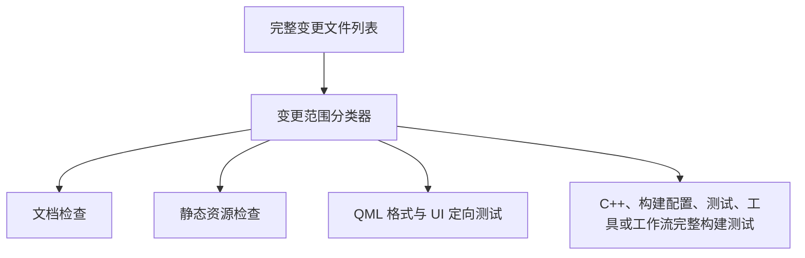

# GitHub Actions 工作流依赖关系

## 工作流分类

### 持续集成 (CI)
- `build.yml` - 变更范围分类、统一验证计划、分类器回归测试，以及按范围选择的多平台构建和测试
- `docs-check.yml` - MkDocs 文档构建检查
- `actionlint.yml` - GitHub Actions 工作流检查
- `clang-format.yml` - 代码格式检查
- `comment-policy.yml` - 源码注释率与注释策略检查
- `security.yml` - 安全检查

### 持续部署 (CD)
- `pack-linux.yml` - Linux 打包
- `pack-macos.yml` - macOS 打包
- `pack-windows.yml` - Windows 打包
- `release.yml` - 汇总各平台打包产物并发布 GitHub Release
- `deploy-docs.yml` - 文档部署

### 自动化与辅助
- `label.yml` - PR 自动标签
- `.github/actions/setup-env` - 环境配置 Composite Action
- `.github/actions/get-version` - 版本号提取 Composite Action (新增)
- `.github/actions/setup-msvc` - Windows MSVC 环境 Composite Action
- `.github/actions/setup-vcpkg` - vcpkg 环境 Composite Action

## 全局策略

### 并发控制 (Concurrency)
主要 CI/CD 工作流配置了并发控制组 (`group: ${{ github.workflow }}-${{ github.ref }}`)。构建和打包工作流会在同一分支或标签有新运行时取消旧运行以节省资源；`release.yml` 不自动取消，避免发布过程被后续手动重跑中断。

### 权限控制 (Permissions)
遵循最小权限原则，每个工作流显式声明所需的 `GITHUB_TOKEN` 权限（例如 `contents: read` 或 `contents: write`）。

### 按变更范围选择检查

PR 工作流由 GitHub 事件触发；分支保护所需的检查工作流不使用 PR 级路径过滤，确保每个 PR 都能生成稳定状态。
随后由 `tools/python/classify_ci_changes.py` 根据目标分支到 PR HEAD 的完整 diff 选择工作流内的检查。分类器使用
`git diff --name-status -z --find-renames --find-copies`，因此删除和重命名文件的两个路径都会参与判断；无法取得
base/head SHA、无法读取完整 diff 或无法识别路径时，统一回退到完整验证。

分类规则和工作流对应关系如下：

| 变更范围 | 分类器结果 | 运行的主要检查 | 跳过的检查 |
|----------|------------|----------------|------------|
| 仅 Markdown、文档配置或文档模板 | `docs-only` | `docs-check` 与必需检查轻量入口 | 平台构建、CTest、clang-format、注释重任务 |
| 仅分类器及其回归测试 | `classifier-only` | Build 中的分类器测试、Python 回归测试 | 平台构建 |
| 仅 QML | `qml-only` | Build 中的 UI 检查 | 平台构建、C++ 格式检查 |
| 仅独立静态资源 | `resources-only` | Build 中的资源检查 | 平台构建、CTest |
| C++、普通测试、工具、依赖、CMake 或工作流 | `full` | 多平台构建、CTest、格式和相关策略检查 | 无 |
| 可安全识别的跨类型变更 | `mixed` | 运行所有适用的定向检查 | 不适用的定向检查和平台构建 |
| 无法安全分类或分类信息缺失 | `full-fallback` | 完整验证 | 无 |

- 仅 Markdown、文档模板或文档配置变更：保留文档构建，不运行平台 C++ 构建和 CTest；文档目录内的 JSON、YAML
  或其他非文档配置文件按完整验证处理，避免把可能影响工具或构建的文件误判为纯文档。
- 仅独立静态资源变更：运行资源完整性检查，不运行无关 C++ 构建。
- 仅 `src/ui/qml/` 下的 QML 变更：运行 QML 格式检查和 Linux UI 定向测试。
- C++、头文件、CMake、依赖、一般测试、Python 工具、打包配置或工作流目录中的 YAML 配置、
  `.github/actions/**` 配置变更：运行完整平台构建和测试；工作流 Markdown 和 Action 目录中的文档除外。
  仅当变更严格限定为
  `tools/python/classify_ci_changes.py` 和/或
  `tests/python/test_classify_ci_changes.py` 时，运行分类器定向测试，不触发平台构建；这两个文件与其他代码、测试或工具
  混合变更时仍回退到完整验证。
- 跨类型变更：同时运行所有适用检查；只要包含无法安全分类的路径，就执行完整验证。

文档-only PR 仍会启动 `build.yml`、`clang-format.yml`、`actionlint.yml`、`comment-policy.yml` 和
`security.yml` 的轻量入口，以保证分支保护所需的检查始终生成；分类器会在工作流内部跳过平台构建、格式和
注释重任务，注释策略在没有 C/C++ 变更时直接成功，依赖审查则正常完成无依赖差异的检查。
工作流 YAML 变更会由 `docs-check.yml` 校验依赖文档一致性，并由 `security.yml` 校验 Action 依赖风险。
`docs-check.yml` 本身也始终生成 `check-docs`，同时覆盖 AI 一致性、验证策略和测试样本校验；这些工作流的 PR
入口不使用路径过滤，因此不会因 required check 缺少运行而长期处于 pending。

## 触发条件

| 工作流 | Push | PR | Tag | Schedule | Manual |
|--------|------|-----|-----|----------|--------|
| build.yml | ✓ | ✓ | ✗ | ✗ | ✓ |
| actionlint.yml | ✓ | ✓ | ✗ | ✗ | ✓ |
| clang-format.yml | ✓ | ✓ | ✗ | ✗ | ✓ |
| comment-policy.yml | ✗ | ✓ | ✗ | ✗ | ✗ |
| docs-check.yml | ✗ | ✓ | ✗ | ✗ | ✓ |
| security.yml | ✗ | ✓ | ✗ | ✓ | ✗ |
| label.yml | ✗ | ✓ | ✗ | ✗ | ✗ |
| pack-linux.yml | ✗ | ✗ | ✗ | ✗ | ✓ |
| pack-macos.yml | ✗ | ✗ | ✗ | ✗ | ✓ |
| pack-windows.yml | ✗ | ✗ | ✗ | ✗ | ✓ |
| release.yml | ✓ | ✗ | ✓ | ✗ | ✓ |
| deploy-docs.yml | ✓ | ✗ | ✗ | ✗ | ✓ |

表中的 `✓` 表示工作流具备该事件触发器。当前分支保护所需的 `build.yml`、`clang-format.yml`、`actionlint.yml`、
`comment-policy.yml`、`security.yml` 和 `docs-check.yml` 均不使用 PR 级路径过滤；前五个工作流在工作流内部
根据分类结果跳过或执行任务，`docs-check.yml` 始终执行一致性、验证策略和样本校验。`push` 事件的构建与格式
工作流仍可使用文档忽略规则节省资源。

## 超时配置

| 工作流 | 超时时间 |
|--------|----------|
| build.yml (Linux) | 60 分钟 |
| build.yml (Windows) | 90 分钟 |
| build.yml (macOS) | 75 分钟 |
| release.yml | 180 分钟 |
| pack-windows.yml | 120 分钟 |
